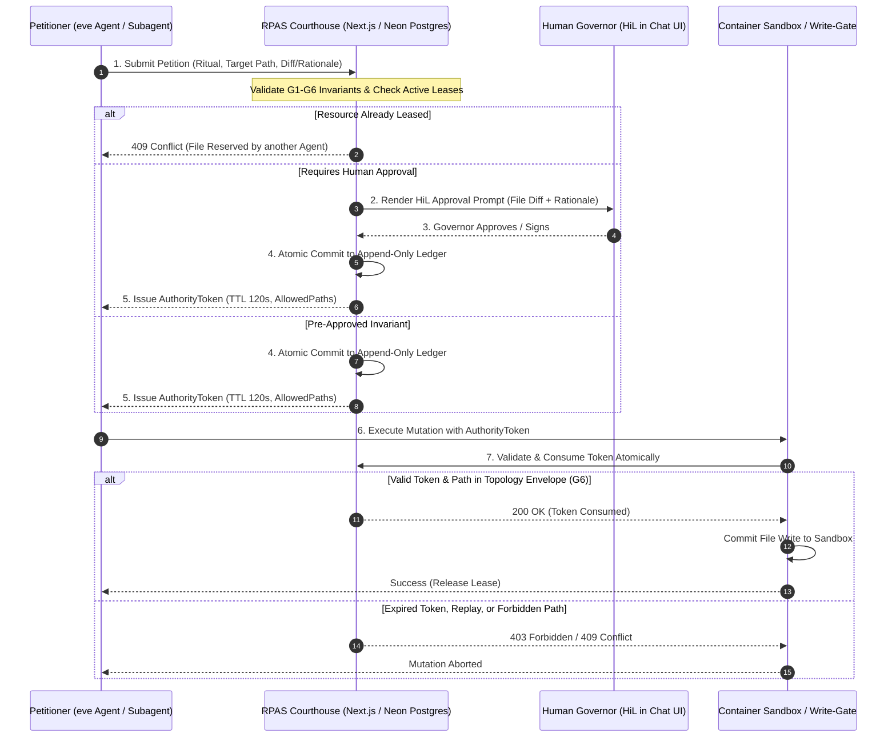

# RPAS Sovereign Governance Backlog

**Status**: Parked on Backlog  
**Reference Specification**: [CSR-42 Certified Authority](https://github.com/mdresch/RPAS-Governance)  
**Target Integration**: eve Chat Template (`mdresch/eve-chat-template`)

---

## Overview

This backlog item covers integrating the **RPAS Sovereign Governance Authority (Courthouse)** methodology into the eve chat template to enforce process integrity, append-only auditability, file reservation locking (preventing agent/subagent collisions), Human-in-the-Loop (HiL) gating, and providing a clean pathway from passive container sandboxes to active container agents with multi-agent orchestration.

---

## 1. Core Invariants (CSR-42)

- **G1 (Sovereign Authority)**: Agents and subagents act strictly as **Petitioners**. The courthouse is the sole authority with persistence rights.
- **G2 (Law as Code)**: Mutations must satisfy strict structural models and invariant rules.
- **G3 (Atomic Execution)**: Validation, ledger commit, and lease issuance happen in a single atomic transaction.
- **G4 (Audit Lineage)**: Every transition generates an append-only, tamper-evident ledger entry in PostgreSQL.
- **G5 (Read vs Act)**: Clear separation between querying state and executing mutations.
- **G6 (Topology Enforcement)**: Mutations are mechanically bound to ritual-specific file envelopes (e.g. `AllowedPaths: ["/workspace/docs/ratified/*"]`). Writes outside the envelope trigger `403 Forbidden`.

---

## 2. Architecture & Authority Chain

---

## 3. Implementation Phases

### Phase A: Persistence & Schema Layer (`lib/db/schema.ts`)
1. **`governance_ledger` (G4 Invariant)**:
   - `id`: UUID (Primary Key)
   - `ritualType`: Text (`"FileAmendment"`, `"ResourceReservation"`, `"Phase0"`, `"CodeRatification"`)
   - `sessionId`: Text (eve session ID)
   - `petitionerId`: Text (Root agent or subagent principal ID)
   - `status`: Text (`"Completed"`, `"Rejected"`, `"Revoked"`)
   - `payloadJson`: Text (Full-fidelity audit snapshot of input parameters and diff)
   - `governorNotes`: Text (Human-in-the-Loop approval justifications or rejection reasons)
   - `hash`: Text (SHA-256 integrity hash)
   - `previousHash`: Text (Cryptographic chain link ensuring tamper-evident immutability)
   - `createdAt`: Timestamp with timezone
2. **`authority_tokens` (CSR-42 Section 5)**:
   - `id`: UUID (Primary Key)
   - `ritualType`: Text
   - `entityId`: Text (Target file path or resource identifier)
   - `allowedPaths`: JSONB (`string[]`) — **Topology Envelope (G6)**
   - `isConsumed`: Boolean (Defaults to `false`)
   - `issuedAt`: Timestamp
   - `expiresAt`: Timestamp (Strict TTL: 120 seconds)
3. **`resource_leases` (Concurrency & Collision Prevention)**:
   - `id`: UUID (Primary Key)
   - `resourcePath`: Text (Unique canonical `/workspace/...` path)
   - `heldByPetitioner`: Text (Agent / subagent session holding the lease)
   - `acquiredAt`: Timestamp
   - `expiresAt`: Timestamp (Lease timeout to prevent deadlocks)

### Phase B: The RPAS Courthouse Service (`lib/governance/rpas-courthouse.ts`)
Centralized courthouse service exposing:
- `validatePetition(petition: PetitionRequest)`
- `acquireResourceLease(path: string, petitionerId: string)`
- `issueAuthorityToken(petition: PetitionRequest, governorNotes?: string)`
- `consumeAuthorityToken(tokenId: string, targetPath: string)`
- `releaseResourceLease(path: string, petitionerId: string)`

### Phase C: Governed Container Tools & HiL Gating (`agent/tools/governed_write.ts`)
- Wrap sandbox write operations with the RPAS ceremony.
- Enforce eve's `approval: async ({ session, toolInput }) => ...` for Human-in-the-Loop review.
- Consume tokens atomically upon mutation.

### Phase D: Multi-Agent Orchestration & Container Agent Nodes
- Transition from passive sandbox containers to container agent nodes running dedicated eve worker loops.
- Host agent acts as High-Level Orchestrator and Governance Arbiter.
- Dynamic subtree partitioning (`/workspace/service-a/*`).

---

## 4. Acceptance Criteria
- [ ] Concurrent subagents attempting to modify the same file receive `409 Conflict (File Reserved)`.
- [ ] Mutations outside authorized topology envelopes receive `403 Forbidden`.
- [ ] Every ratified file amendment creates an immutable entry in `governance_ledger` with verifiable SHA-256 chain integrity.
- [ ] Human governors can approve or reject file amendments directly via the chat UI approval prompts.
