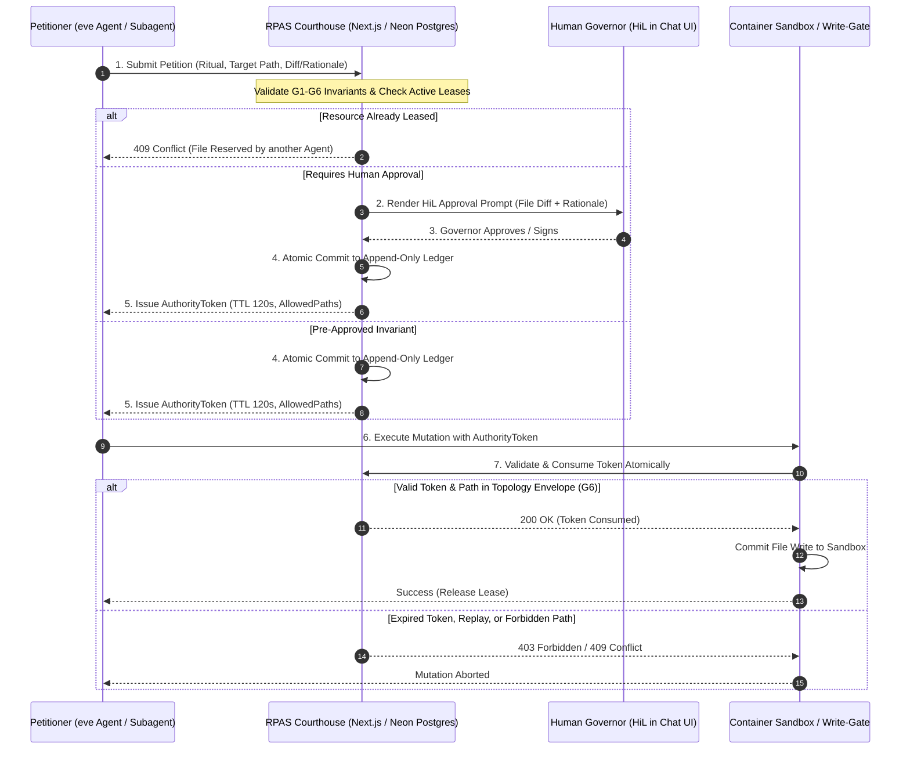

# Architectural Specification & Implementation Plan: RPAS Sovereign Governance

Integrate the **RPAS Sovereign Governance Authority (Courthouse)** methodology ([CSR-42 Certified](https://github.com/mdresch/RPAS-Governance)) into the eve chat template to enforce process integrity, append-only auditability, file reservation locking (preventing agent/subagent collisions), Human-in-the-Loop (HiL) gating, and provide a clear passage from passive container sandboxes to active container agents with multi-agent orchestration.

---

## 1. Executive Summary & Problem Statement

### The Problem
1. **Agent Concurrency & Sandbox Collision**: When multiple subagents or parallel agent steps run within the container sandbox, simultaneous writes to the same files lead to race conditions, overwritten code, and state corruption.
2. **Missing Authoritative Gate**: Built-in sandbox tools (`bash`, `write_file`) currently execute commands without cryptographic audit trails, topology restrictions, or explicit jurisdictional leases.
3. **Execution Bottleneck**: When upstream model calls encounter authentication or rate-limit issues, the agent cannot complete step 0, leaving the execution stuck in the initial planning phase.

### The Solution: RPAS Sovereign Governance (CSR-42)
Adopt the battle-tested **Law-as-Code** and **Topology Sovereignty** architecture from [`mdresch/RPAS-Governance`](https://github.com/mdresch/RPAS-Governance):
- **G1 (Sovereign Authority)**: Agents and subagents act strictly as **Petitioners**. The courthouse is the sole authority with persistence rights.
- **G2 (Law as Code)**: Mutations must satisfy strict structural models and invariant rules.
- **G3 (Atomic Execution)**: Validation, ledger commit, and lease issuance happen in a single atomic transaction.
- **G4 (Audit Lineage)**: Every transition generates an append-only, tamper-evident ledger entry in PostgreSQL.
- **G5 (Read vs Act)**: Clear separation between querying state and executing mutations.
- **G6 (Topology Enforcement)**: Mutations are mechanically bound to ritual-specific file envelopes (e.g., `AllowedPaths: ["/workspace/docs/ratified/*"]`). Writes outside the envelope trigger `403 Forbidden`.

---

## 2. Architecture & Authority Chain



---

## 3. Core Building Blocks & Proposed Code Changes

### Phase A: Persistence & Database Layer ([`lib/db/schema.ts`](file:///d:/Source/eve-chat-template/lib/db/schema.ts))

Add three dedicated relational tables to the Neon Postgres schema:

#### 1. `governance_ledger` (CSR-42 G4 Invariant)
Append-only immutable record of all petitions, approvals, and outcomes:
- `id`: UUID (Primary Key)
- `ritualType`: Text (`"FileAmendment"`, `"ResourceReservation"`, `"Phase0"`, `"CodeRatification"`)
- `sessionId`: Text (eve session ID)
- `petitionerId`: Text (Root agent or subagent principal ID)
- `status`: Text (`"Completed"`, `"Rejected"`, `"Revoked"`)
- `payloadJson`: Text (Full-fidelity audit snapshot of input parameters and diff)
- `governorNotes`: Text (Human-in-the-Loop approval justifications or rejection reasons)
- `hash`: Text (SHA-256 integrity hash)
- `previousHash`: Text (Cryptographic chain link ensuring tamper-evident immutability)
- `createdAt`: Timestamp with timezone

#### 2. `authority_tokens` (CSR-42 Section 5)
Single-use authorization tokens issued upon successful petition validation:
- `id`: UUID (Primary Key)
- `ritualType`: Text
- `entityId`: Text (Target file path or resource identifier)
- `allowedPaths`: JSONB (`string[]`) — **Topology Envelope (G6)**
- `isConsumed`: Boolean (Defaults to `false`)
- `issuedAt`: Timestamp
- `expiresAt`: Timestamp (Strict TTL: 120 seconds)

#### 3. `resource_leases` (Concurrency & Collision Prevention)
Exclusive distributed locks preventing agents and subagents from amending the same files concurrently:
- `id`: UUID (Primary Key)
- `resourcePath`: Text (Unique canonical `/workspace/...` path)
- `heldByPetitioner`: Text (Agent / subagent session holding the lease)
- `acquiredAt`: Timestamp
- `expiresAt`: Timestamp (Lease timeout to prevent deadlocks)

---

### Phase B: The RPAS Courthouse Service ([NEW] [`lib/governance/rpas-courthouse.ts`](file:///d:/Source/eve-chat-template/lib/governance/rpas-courthouse.ts))

Author a centralized TypeScript service directly mirroring `RPAS.Governance.Core`:
```ts
export type PetitionRequest = {
  ritualType: "FileAmendment" | "ResourceReservation" | "CodeRatification";
  petitionerId: string;
  sessionId: string;
  targetPath: string;
  content?: string;
  justification: string;
};

export class RpasCourthouse {
  // 1. Evaluate G1-G6 invariants and topology envelope
  async validatePetition(petition: PetitionRequest): Promise<ValidationResult>;

  // 2. Acquire resource lease (blocks or rejects overlapping writes)
  async acquireResourceLease(path: string, petitionerId: string): Promise<Lease>;

  // 3. Commit ledger entry & issue single-use AuthorityToken (TTL 120s)
  async issueAuthorityToken(petition: PetitionRequest, governorNotes?: string): Promise<AuthorityToken>;

  // 4. Validate & consume AuthorityToken atomically upon write execution
  async consumeAuthorityToken(tokenId: string, targetPath: string): Promise<boolean>;

  // 5. Release resource lease upon completion
  async releaseResourceLease(path: string, petitionerId: string): Promise<void>;
}
```

---

### Phase C: Governed Container Tools & HiL Gating ([NEW] [`agent/tools/governed_write.ts`](file:///d:/Source/eve-chat-template/agent/tools/governed_write.ts))

Wrap the sandbox write operations with the RPAS ceremony:
- **Approval Policy**:
  ```ts
  approval: async ({ session, toolInput }) => {
    const courthouse = getRpasCourthouse();
    const policy = await courthouse.evaluatePolicy(toolInput?.filePath, toolInput?.justification);
    
    // Durably pauses turn and renders the HiL review prompt in the chat UI
    return policy.requiresHumanApproval ? "user-approval" : "approved";
  }
  ```
- **Execution Flow**:
  1. Petitions the Courthouse for the target `/workspace/...` file.
  2. Acquires exclusive lease in `resource_leases` (prevents subagent collision).
  3. Receives single-use `AuthorityToken` (TTL 120s).
  4. Invokes `sandbox.writeTextFile(...)` through the write-gate.
  5. Atomically consumes token in `authority_tokens` and writes immutable record to `governance_ledger`.
  6. Releases lease for downstream agents.

---

### Phase D: Evolution from Passive Container to Container Agent + Orchestration

| Attribute | Current State (Phase 1) | Governed Container (Phase 2) | Container with Agent + Orchestration (Phase 3) |
| :--- | :--- | :--- | :--- |
| **Container Role** | Passive sandbox running `ghcr.io/vercel/eve:latest`. | Governed sandbox with topology envelopes (G6). | **Autonomous Subagent Node**: Runs internal eve worker process. |
| **Orchestration** | Single host agent driving tools. | Host agent driving subagents with file reservation leases. | **Distributed Multi-Agent Bus**: Host agent acts as High-Level Orchestrator & Governance Arbiter. |
| **Collision Prevention** | Manual non-overlapping scopes. | **RPAS Distributed Leases**: Database-enforced file locks per turn. | **Dynamic Partitioning**: Containers assigned isolated subtrees (`/workspace/service-a/*`). |
| **Audit & Lineage** | Chat SSE event log. | **CSR-42 Cryptographic Ledger**: Permanent SHA-256 chain. | **Federated Audit Mesh**: Cross-container petition logs verified by Courthouse. |
| **Human Supervision** | Turn-level approvals. | **Gated Mutation Ceremonies**: HiL prompt with diff & justification. | **Policy Hierarchy**: Critical code changes require Governor sign-off; standard tasks auto-ratified. |

---

## 4. Resolving the "Analyzing Request & Planning Tasks" Bottleneck

Before locking down the ledger, the agent execution pipeline must run end-to-end without stalling at Step 0:

### Cause of the Stall
1. **Model Fallback Failure**: In local development without an explicit Anthropic API key, the default model `anthropic/claude-sonnet-5` falls back to Vercel AI Gateway, which returned `401 Unauthorized (AI Gateway received no credentials)`.
2. **UI Error Masking**: When `step.failed` or `turn.failed` was emitted, the earlier progress indicator stayed in `status: "in_progress"`, making it look like planning was running indefinitely.

### Implemented Fixes
1. **Real-time Failure Reflection in [`components/chat/task-progress.tsx`](file:///d:/Source/eve-chat-template/components/chat/task-progress.tsx)**:
   Updated `deriveTaskSteps` to intercept `step.failed`, `turn.failed`, and `session.failed` events. The active step now immediately transitions to:
   `✕ Analyzing request & planning tasks` with the exact error details (e.g. `AI Gateway authentication failed`).
2. **Provider Configuration Step**:
   To allow prompt instructions to proceed through tools and synthesis:
   - Navigate to **`http://localhost:3000/settings`**.
   - Re-save your provider credentials (e.g. **Bifrost** on `http://localhost:8080/v1` or **Google Gemini** / **Anthropic** key).
   - Once saved, `buildModelFromCredential` will decrypt successfully and prompts will transition seamlessly through:
     `Planning` $\to$ `Tools` $\to$ `Synthesis`!

---

## 5. Implementation Roadmap & Milestones

1. **Milestone 1 (Foundations)**:
   - Apply Drizzle migration for `governance_ledger`, `authority_tokens`, and `resource_leases`.
   - Implement `lib/governance/rpas-courthouse.ts` with G1–G6 invariant checks.
2. **Milestone 2 (Governed Tool & HiL Integration)**:
   - Implement `agent/tools/governed_write.ts` with 120s AuthorityToken verification and topology envelopes.
   - Connect eve's `approval: ({ session, toolInput }) => ...` for human review before lease issuance.
3. **Milestone 3 (Audit & Telemetry Surface)**:
   - Add a "Governance & Leases" panel to the UI showing active resource locks, token lifecycle, and ledger audit history.
4. **Milestone 4 (Multi-Agent Container Orchestration)**:
   - Author a declared subagent in `agent/subagents/container_worker/` running within an isolated workspace envelope, completing the passage to container orchestration.
